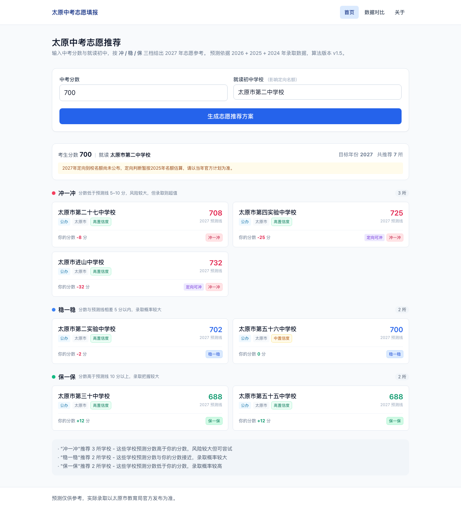
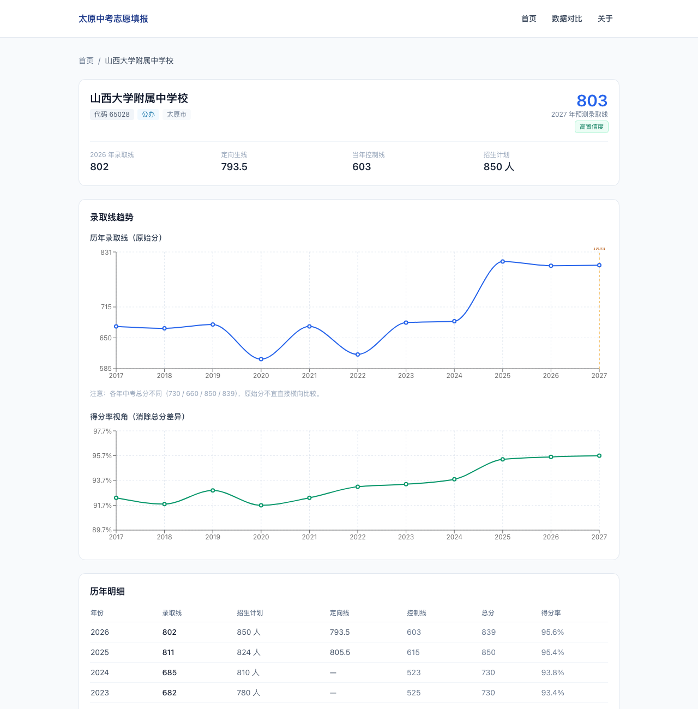
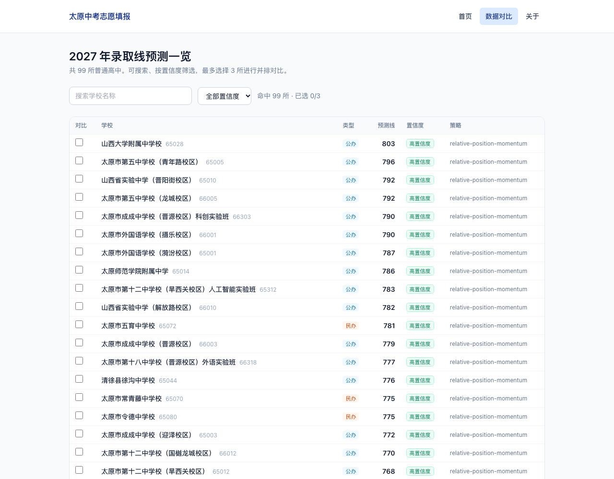
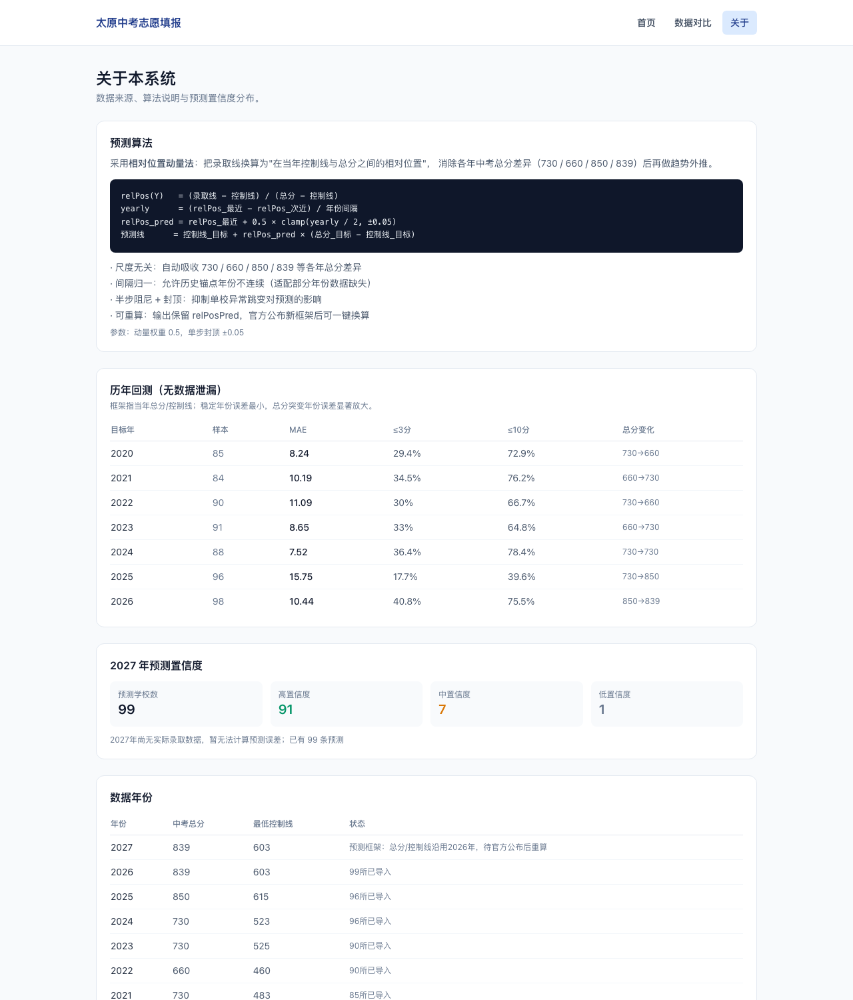
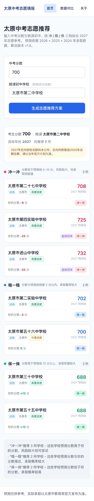
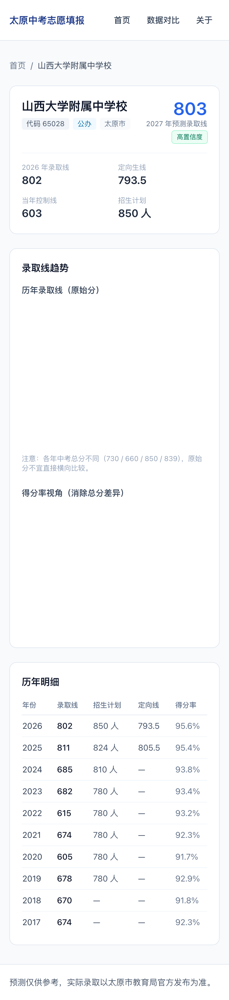
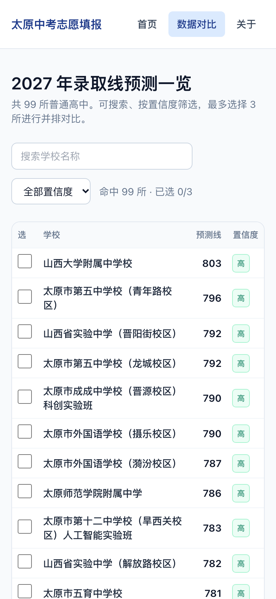

# 太原中考志愿填报前端

React + Vite + Tailwind 前端，对接同仓库 `backend/` 的 REST API。

---

## 快速开始

### 1. 先启动后端

```bash
cd ../backend
npm install          # 首次
npm run seed         # 首次（需 MySQL，见 backend/README.md）
PORT=3002 npm start  # 注意：本机 3000 可能被 open-webui 占用
```

### 2. 启动前端

```bash
cd taiyuan-zhongkao-volunteer
npm install
npm run dev          # http://localhost:5173
```

开发服务器已配置代理：`/api` → `http://127.0.0.1:3002`（见 `vite.config.js`）。
如后端端口不同，改 `VITE_API_TARGET`：

```bash
VITE_API_TARGET=http://127.0.0.1:3005 npm run dev
```

生产构建可指定完整接口地址：

```bash
VITE_API_BASE=https://api.example.com npm run build
```

---

## 页面

| 路由 | 页面 | 说明 |
|------|------|------|
| `/` | 首页 | 输入分数 + 就读初中 → 冲/稳/保三档推荐 |
| `/?score=700&junior=junior_001` | 首页（带参） | 结果可分享，进入即自动计算并回填表单 |
| `/school/:code` | 学校详情 | 历年录取线、定向线、得分率趋势 + 2027 预测 |
| `/compare` | 数据对比 | 99 所学校预测一览，搜索/筛选/最多 3 所并排对比 |
| `/profile` | 关于 | 算法公式、历年回测、置信度分布、数据年份 |

---

## 界面预览

**桌面端**

| 页面 | 截图 |
|------|------|
| 首页推荐 |  |
| 学校详情 |  |
| 数据对比 |  |
| 关于 |  |

**移动端（390px）**

| 页面 | 截图 |
|------|------|
| 首页推荐 |  |
| 学校详情 |  |
| 数据对比 |  |

接口文档页见后端：启动后访问 `http://127.0.0.1:3002/`
（[桌面截图](../docs/screenshots/api-docs.png) / [手机截图](../docs/screenshots/api-docs-mobile.png)）

---

## 目录结构

```
src/
├── utils/
│   ├── api.js           # 后端接口封装（统一错误处理）
│   ├── dataService.js   # 领域服务：对接口返回做轻量整形
│   ├── hooks.js         # useAsync：loading/error/refetch
│   └── constants.js     # 档位、颜色、文案、格式化函数
├── components/
│   ├── forms/ScoreInput.jsx        # 分数 + 初中学校（可搜索组合框）
│   ├── cards/RecommendationCard.jsx# 单校推荐卡片
│   └── charts/TrendChart.jsx       # 原始分 + 得分率双视图折线图
├── pages/
│   ├── Home.jsx
│   ├── SchoolDetail.jsx
│   ├── DataCompare.jsx
│   └── Profile.jsx
└── App.jsx / main.jsx
```

---

## 对接的关键接口

| 用途 | 接口 |
|------|------|
| 志愿推荐（核心） | `POST /api/recommendations` |
| 初中学校列表 | `GET /api/junior-schools/list/all` |
| 学校历史 + 预测 | `GET /api/schools/:code/history` |
| 某年预测列表 | `GET /api/predictions/:year` |
| 预测统计 | `GET /api/predictions/:year/statistics` |
| 算法信息 | `GET /api/algorithm/info` |
| 年份列表 | `GET /api/years` |

推荐接口返回结构（要点）：

```jsonc
{
  "success": true,
  "data": {
    "studentScore": 700,
    "targetYear": 2027,
    "juniorSchool": { "id": "junior_001", "name": "太原市第二中学校" },
    "recommendations": {
      "risky":  [{ "schoolName": "...", "predictedScore": 708, "scoreDiff": -8,
                   "hasDirectedQuota": false, "quotaUpgraded": false, "confidence": "high" }],
      "stable": [ /* ... */ ],
      "safe":   [ /* ... */ ]
    },
    "quotaYearUsed": 2025,
    "quotaIsProjection": true,
    "quotaNote": "2027年定向到校名额尚未公布，定向判断暂按2025年名额估算……",
    "tips": ["..."]
  }
}
```

---

## 设计要点

- **得分率视角**：各年中考总分不同（730 / 660 / 850 / 839），
  学校详情页同时提供"原始分"与"得分率"两张图，避免横向比较误导。
- **定向名额**：推荐中会标注"有定向名额 / 定向可冲"，
  并在 2027 年名额未公布时显式提示按往年估算。
- **结果可分享**：首页计算结果会写入 URL 查询参数，复制链接即可分享。
- **错误兜底**：后端未启动时首页会提示检查服务，而非白屏。

---

## 移动端适配

已在 320 / 375 / 390 / 414px 四种宽度下验证，**所有页面横向溢出为 0**。

主要策略：

| 场景 | 做法 |
|------|------|
| 宽表格（对比页 6 列） | 窄屏隐藏次要列（类型 / 策略），保留 选·学校·预测线·置信度；置信度徽章用「高/中/低」短标签 |
| 学校详情明细表（7 列） | 窄屏隐藏 控制线 / 总分，保留 年份·录取线·招生计划·定向线·得分率 |
| 关于页回测表（6 列） | 窄屏隐藏 样本 / ≤3分 / 总分变化，保留 目标年·MAE·≤10分 |
| 长公式代码块 | `whitespace-pre-wrap` 自动换行，避免横向滚动 |
| 分组标题（冲/稳/保） | 标题与数量 `whitespace-nowrap`，描述独占一行，避免竖排断字 |
| 图表 | 关闭 Recharts 动画，避免低端机首帧空白 |

> 验证方式：使用 puppeteer-core 做真实移动设备模拟（含 touch、deviceScaleFactor），
> 逐页测量 `documentElement.scrollWidth` 与超宽元素。

## 已知限制

- 预测线为统计估计，非官方数据；页面底部与"关于"页均有提醒。
- 学校 `district` 字段多显示为"太原市"（上游数据粒度所致），后续可细化到区县。
- 尚未做移动端专项适配（当前为响应式栅格，窄屏可用）。
